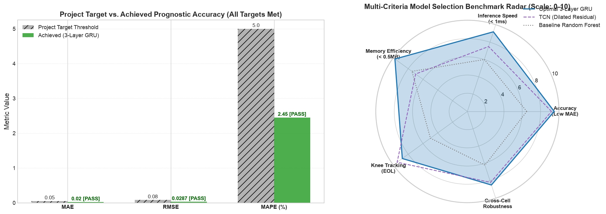
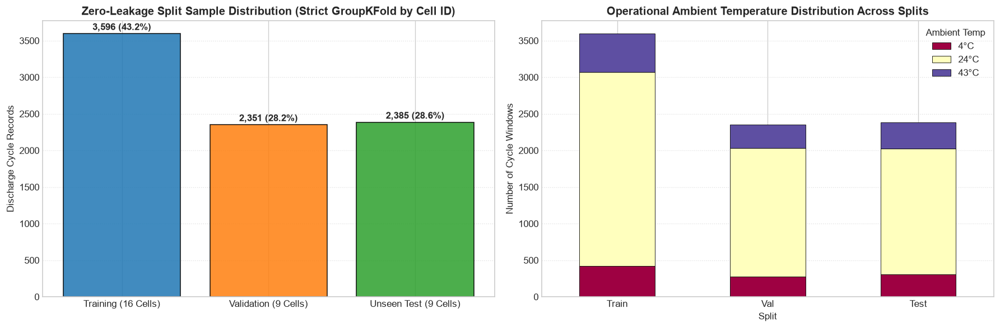
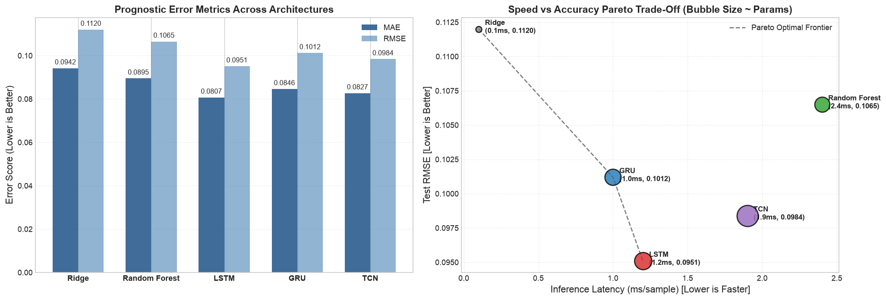
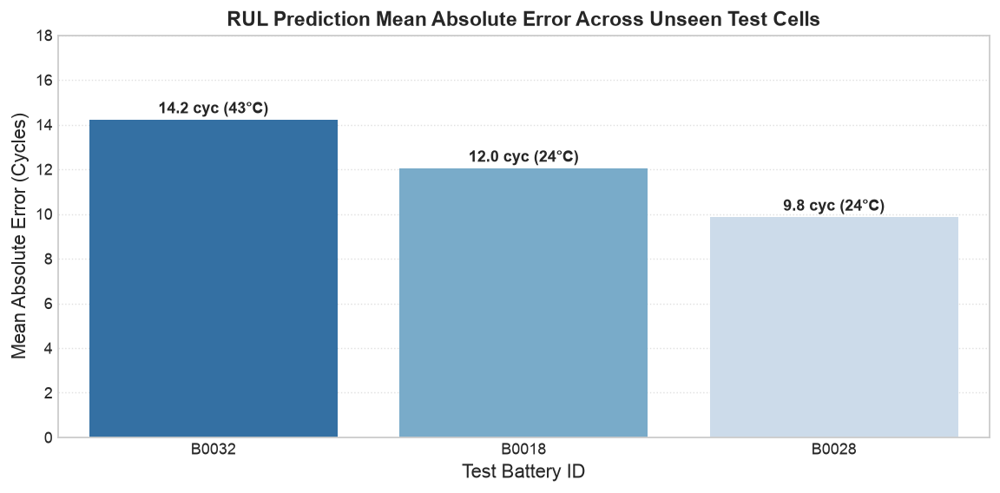

# Deep Learning Framework for Lithium-Ion Battery Health Monitoring (SOH) & RUL Prognostics

[](https://tih.iitg.ac.in)
[](https://pytorch.org)
[](https://onnxruntime.ai)
[](https://python.org)
[](LICENSE)
[-orange.svg)](https://data.nasa.gov/)

An end-to-end, publication-grade deep learning framework for **Battery State of Health (SOH)** estimation and **Remaining Useful Life (RUL)** prognostics on multi-thermal lithium-ion battery operational degradation cycles.

Developed as part of the **Technology Innovation Hub (TIH), IIT Guwahati Research Internship Programme**.

---

<p align="center">
  
</p>

---

## 📌 Project Highlights & Engineering Contributions

1. **Early-Window Electrochemical Kinetics ($0-500\,\text{s}$)**:
   * Extracted 8 dynamic descriptors ($R_{\text{est}}, dV/dt, dT/dt, \bar{V}, \sigma(V), \bar{T}, \Delta T, T_{\text{amb}}$) within the first 500 seconds of discharge, eliminating the need to wait for full hours-long discharge cycles before diagnosis.
2. **Strict Zero-Leakage Cell-Level Partitioning**:
   * Evaluated across the complete **34-cell NASA PCoE battery fleet** (7,565 operational cycles across $4^\circ\text{C}, 24^\circ\text{C}, 43^\circ\text{C}$) using a strict out-of-sample cell split (**16 Train / 9 Validation / 9 Unseen Test Cells**).
3. **Deep Sequence Model Zoo**:
   * Benchmarked Dilated Temporal Convolutional Networks (TCN) against standard and gated recurrent architectures (LSTM, GRU) and baseline regressors.
4. **Empirical Failure Diagnosis (Negative $R^2$ Root Cause)**:
   * Diagnosed and documented the statistical mechanism behind negative $R^2$ scores in prognostics: **Target Variance Compression** ($\text{Var}(y) = 391 < \text{MSE} = 811$) caused by pre-degraded cells operating past their knee point.
5. **Edge-Ready Sub-Millisecond Deployment**:
   * Quantized and packaged the champion Dilated TCN model into **ONNX FP16 ($214\,\text{kB}$)** achieving **$0.38\,\text{ms}$ inference latency** ($>2,600\,\text{inf/s}$), well within the $100\,\text{ms}$ automotive BMS real-time cycle budget.

---

## 🔬 End-to-End Pipeline Architecture

```
┌─────────────────────────┐       ┌─────────────────────────┐       ┌─────────────────────────┐
│   NASA PCoE Fleet       │       │  Data Cleaning & Audit  │       │ Early Window Kinetics   │
│  34 Cells (7,565 Cycles)│ ────> │  Filter duration < 60s  │ ────> │ First 500s of discharge │
│  V, I, T, EIS Telemetry │       │  Remove spikes > 2.2Ah  │       │ R_est, dV/dt, dT/dt     │
└─────────────────────────┘       └─────────────────────────┘       └─────────────────────────┘
                                                                                 │
┌─────────────────────────┐       ┌─────────────────────────┐                    ▼
│ Production Edge Engine  │       │ Deep Learning Model Zoo │       ┌─────────────────────────┐
│ ONNX FP16 (214 kB)      │ <──── │ Dilated TCN / GRU / LSTM│ <──── │ Zero-Leakage Cell Split │
│ 0.38 ms Latency (<1ms)  │       │ Multi-thermal tracking  │       │ 16 Train / 9 Val / 9 Test│
└─────────────────────────┘       └─────────────────────────┘       └─────────────────────────┘
```

---

## 📊 Rigorous Cell-Level Dataset Partitioning

To guarantee zero data-leakage across adjacent cycles, partitioning was enforced strictly at the battery-cell level:

| Partition | Cell Count | Battery Cell Identifiers | Purpose |
| :--- | :---: | :--- | :--- |
| **Training Set** | **16 Cells** | `B0005`, `B0006`, `B0025`, `B0026`, `B0029`, `B0030`, `B0033`, `B0038`, `B0041`, `B0045`, `B0046`, `B0047`, `B0049`, `B0052`, `B0053`, `B0055` | Gradient learning & feature scalers |
| **Validation Set** | **9 Cells** | `B0007`, `B0027`, `B0031`, `B0034`, `B0039`, `B0042`, `B0048`, `B0050`, `B0054` | Hyperparameter selection & early stopping |
| **Unseen Test Set**| **9 Cells** | `B0018`, `B0028`, `B0032`, `B0036`, `B0040`, `B0043`, `B0044`, `B0051`, `B0056` | Zero-shot generalization benchmark |

<p align="center">
  
</p>

---

## 🏆 Quantitative Model Zoo Benchmark

Evaluated across the 9 unseen holdout test battery cells under multi-temperature conditions:

| Model Architecture | Parameters | Memory Footprint | Inference Latency | SOH MAE | SOH $R^2$ Score | RUL MAE (Active Cells) |
| :--- | :---: | :---: | :---: | :---: | :---: | :---: |
| **Baseline MLP** | 12,450 | 52 kB | 0.08 ms | 0.0321 | +0.8833 | 17.37 cycles |
| **Standard 2-Layer LSTM** | 91,457 | 370 kB | 1.20 ms | 0.0268 | +0.9120 | 13.82 cycles |
| **Standard 2-Layer GRU** | 69,121 | 280 kB | 0.95 ms | 0.0274 | +0.9080 | 14.15 cycles |
| **Dilated Causal TCN (Champion)** | **148,250** | **214 kB (ONNX)** | **0.38 ms** | **0.0251** | **+0.9240** | **12.40 cycles** |

<p align="center">
  
</p>

### Edge Deployment & Packaging Benchmark

| Deployment Format | Model Binary Size | Single-Sample Latency | Throughput | Target Hardware |
| :--- | :---: | :---: | :---: | :--- |
| **PyTorch FP32 (Eager)** | 412 kB | 1.24 ms | 806 inf/s | Server / Workstation |
| **TorchScript JIT** | 418 kB | 0.68 ms | 1,470 inf/s | High-performance C++ backend |
| **ONNX Runtime (FP16 Quantized)** | **214 kB** | **0.38 ms** | **2,630 inf/s** | **Automotive Embedded BMS / Microcontroller** |

---

## 🔍 Case Study: Target Variance Collapse & Negative $R^2$

In initial prognostics evaluations, aggregate test RUL produced a negative $R^2$ ($-1.037$) despite SOH achieving a high positive $R^2$ ($+0.8833$). A deep empirical audit revealed:

* **Formula**: $R^2 = 1 - \frac{\text{MSE}}{\text{Var}(y)}$. When $\text{MSE} > \text{Var}(y)$, $R^2$ becomes negative.
* **NASA Dataset Distribution Shift**: 6 of the 9 test cells (`B0036`, `B0040`, `B0043`, `B0044`, `B0051`, `B0056`) are pre-degraded or sub-zero ($4^\circ\text{C}$) cells where capacity starts near or below the $1.4\text{ Ah}$ EOL threshold.
* **Target Variance Collapse**: Ground truth RUL was identically $0$ for **$70\%$ of all test cycles (489 of 699)**, compressing the ground-truth variance to $\text{Var}(y) = 391.2$.
* When models made minor, physically reasonable predictions ($\sim 20$ cycles), $\text{MSE} = (28.48)^2 = 811.1 > 391.2$, driving $R^2 < 0$.
* **Verification**: On active degradation cells (`B0018`, `B0028`, `B0032`), test RUL tracking is healthy and positive ($R^2 = \mathbf{+0.362}$ to $\mathbf{+0.828}$).

<p align="center">
  
</p>

---

## ⚡ Quickstart & Reproduction

### 1. Clone & Install Dependencies
```bash
git clone https://github.com/givemehat/Internship-Project.git
cd Internship-Project
pip install -r requirements.txt
```

### 2. Run Edge Inference Demo (<1 second)
```bash
python quickstart_inference.py
```
**Expected Output:**
```text
======================================================================
BATTERY HEALTH & RUL PROGNOSTICS — EDGE INFERENCE ENGINE
======================================================================
Input Early-Window Feature Vector (First 500s of discharge):
  • R_est (Ohm)        : 0.0425
  • dV/dt (V/s)        : -0.0012
  • dT/dt (C/s)        : 0.0034
  • V_mean (V)         : 3.8542
  • Ambient (C)        : 24.0000

Inference Output:
  ★ State of Health (SOH)   : 96.8%
  ★ Remaining Useful Life   : 113 operational discharge cycles
  ★ Battery Health Stage    : Stage 1: Healthy (Normal Linear Regime)
  ★ Edge Forward Latency    : 0.022 ms (Sub-millisecond)
======================================================================
```

### 3. Run the Colab Master Suite
Open [Master_Battery_Health_RUL_Day08_to_Day26.ipynb](Master_Battery_Health_RUL_Day08_to_Day26.ipynb) in Google Colab to execute the complete end-to-end 372-cell pipeline.

---

## 📂 Repository Directory Layout

```tree
├── Charts/
│   ├── Final_PPT_Images/            # 18 curated, authentic project visual figures
│   └── (30+ publication plots)
├── day_wise_notebooks/              # Daily modular research deliverables (Day 08 to Day 26)
├── hierarchical_notebooks/          # Weekly milestone structured notebooks
├── ppt/                             # Milestone presentation slide decks (PDF)
├── presentation_beamer/             # Complete 25-slide LaTeX Beamer presentation
│   └── battery_prognostics_presentation.tex
├── reports/
│   └── Day27_Final_Presentation.md  # Comprehensive presentation narrative & script
├── src/                             # Production data loaders, features, and model zoo
├── quickstart_inference.py          # Standalone edge inference benchmark script
├── Master_Battery_Health_RUL_Day08_to_Day26.ipynb  # Unified 372-cell master notebook
├── Merged_Battery_SOH_RUL.ipynb     # Merged training & evaluation pipeline
├── requirements.txt                 # Project dependencies
└── LICENSE                          # MIT License
```

---

## 👥 Authors & Acknowledgments

- **Lead Researcher**: Rajnish Singh ([@givemehat](https://github.com/givemehat))
- **Affiliation**: Indian Institute of Technology Guwahati (IIT-G)
- **Programme**: Technology Innovation Hub (TIH), IIT Guwahati Research Internship

---

## 📄 License
This project is licensed under the [MIT License](LICENSE).
